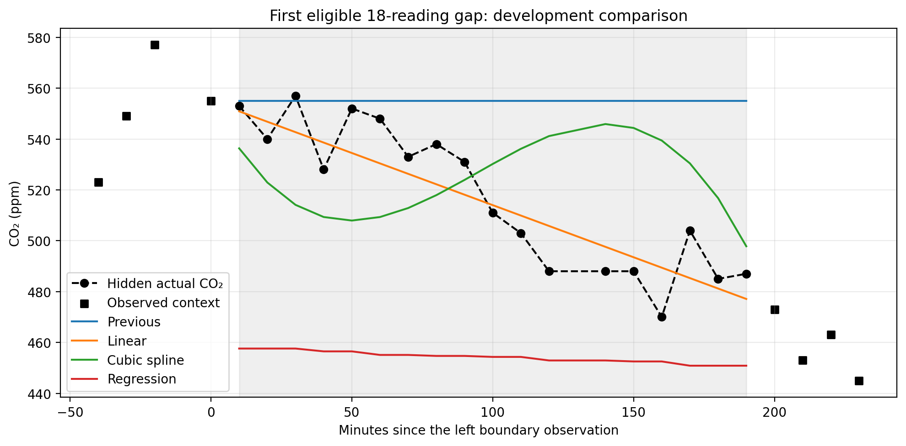
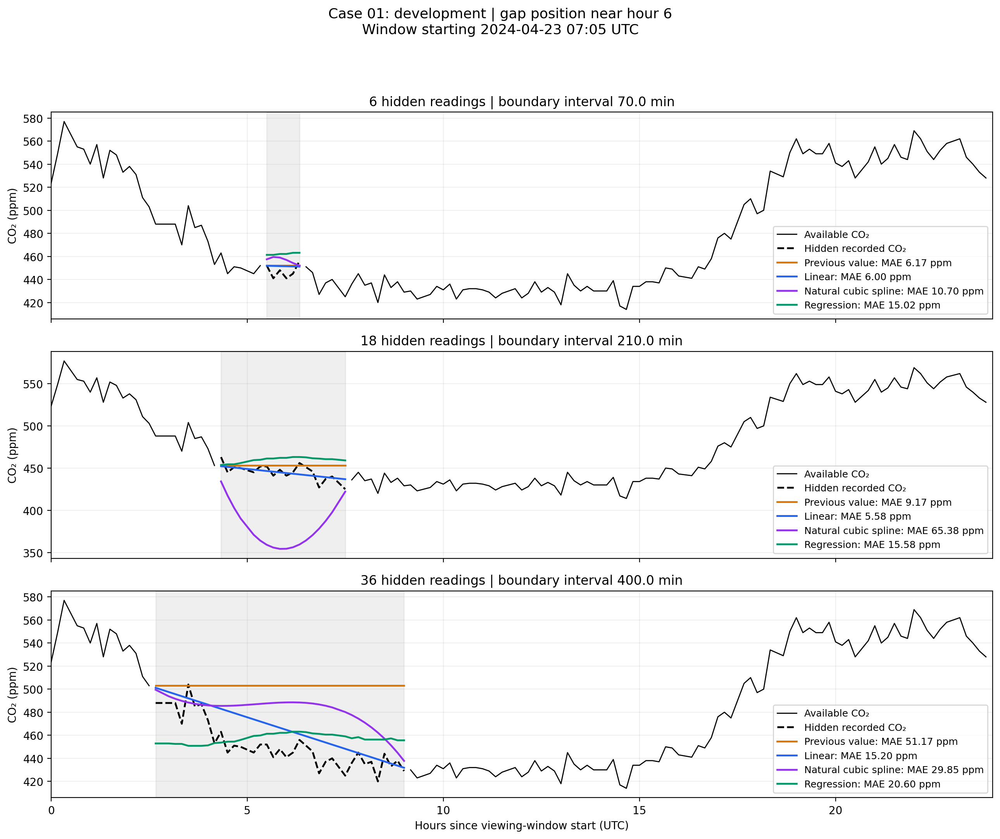

# Reconstructing missing indoor CO₂ sensor readings

## Engineering question

How accurately can missing indoor CO₂ readings be reconstructed using linear interpolation, cubic spline interpolation, and multiple linear regression, and how does reconstruction error change with gap length?

The engineering context is recovering incomplete records used in indoor air-quality and ventilation assessment. This project investigates offline reconstruction: observations after a gap are available before interpolation is performed. Reconstructed values are estimates, not replacement sensor measurements.

## Data and inputs

Source: MMA3001 Dataset 2, Monash Smart Infrastructure environmental sensor data.

The analysis uses sensor `6012002000869` from the original `5EnvSensor_MayToDec2024_180kRows.zip` supplied with the unit.

| Variable | Unit | Use |
| --- | --- | --- |
| Carbon dioxide | ppm | Reconstruction target |
| Temperature | °C | Regression input |
| Humidity | percent | Regression input |
| Pressure | mb | Regression input |
| Measurement timestamp | Unix seconds | Alignment and interpolation |

The audit found 29,341 CSV rows for this sensor and 13,800 distinct CO₂ timestamps. The four selected variables contain 13,800 aligned observations.

`src/compare.py` reads the ZIP directly, which must contain exactly one CSV with `sensorid` and `jsondata` columns. It collapses identical repeated measurements, aligns variables by exact timestamp, and sorts observations chronologically. It rejects invalid or nonfinite measurements, conflicting values, absent variables, and incomplete alignment.

Obtain the original ZIP from the unit's Dataset 2 materials. Keep it outside this public repository. Occupancy data and the example data labelled “Do not use” are not used.

## Methods

| Method | Information used | Role |
| --- | --- | --- |
| Previous value | Last observed CO₂ value before the gap | Baseline |
| Linear interpolation | CO₂ observations immediately before and after the gap; elapsed time | Main numerical method |
| Natural cubic spline | Four observed CO₂ readings on each side of the gap | Alternative numerical method |
| Multiple linear regression | Temperature, humidity and pressure; coefficients fitted on earlier CO₂ observations | Alternative regression method |

The spline uses natural boundary conditions and disables extrapolation. Its predictions are not clipped, so overshoot remains visible in the error evaluation.

Regression includes an intercept and three standardized predictors. Training means, standard deviations, and least-squares coefficients are calculated using training data only. Prediction reuses this scaling without refitting. Regression assumes the other three sensor variables remain available when CO₂ is missing.

Function inputs, outputs, units, assumptions and selected error checks are documented in the source docstrings and HTML documentation.

## Development comparison

Regression trains on the first 50% of chronological observations: 6,900 readings. Artificial gaps are evaluated in the following 25%: 3,450 readings.

For each simulated event, 6, 18 or 36 known CO₂ readings are hidden. All four methods estimate the same hidden targets. Hidden CO₂ values are excluded from reconstruction inputs.

Each event is evaluated independently. Candidate starts are separated by the gap size plus eight readings. A window is skipped if any adjacent timestamp interval exceeds 30 minutes.

Mean absolute error (MAE) and root mean square error (RMSE) compare estimates with the hidden measurements. Both are reported in ppm; smaller values indicate better reconstruction.

### MAE results

| Hidden readings | Gaps evaluated | Previous | Linear | Cubic spline | Regression |
| --- | --- | --- | --- | --- | --- |
| 6 | 246 | 13.05 | 9.81 | 18.49 | 35.19 |
| 18 | 132 | 17.04 | 11.62 | 39.31 | 35.47 |
| 36 | 78 | 30.75 | 16.60 | 75.38 | 35.62 |

### RMSE results

| Hidden readings | Previous | Linear | Cubic spline | Regression |
| --- | --- | --- | --- | --- |
| 6 | 18.16 | 12.82 | 23.61 | 45.93 |
| 18 | 23.49 | 15.22 | 52.10 | 46.16 |
| 36 | 41.68 | 21.88 | 102.62 | 46.34 |

The median elapsed intervals between observations surrounding the gaps are 79.98, 209.97 and 400.00 minutes respectively. A count of hidden readings is not itself a duration.

Linear interpolation has the lowest MAE and RMSE for all three gap sizes in this development segment. This supports it as the current preferred method for these experiments. The result does not establish that linear interpolation is best for every sensor, operating condition or missing-data pattern.

Full results: [co2_method_comparison.csv](co2_method_comparison.csv).

### Example gap



The figure shows the first eligible 18-reading gap, selected by chronological order rather than reconstruction error. It illustrates individual method behaviour; the aggregated errors above provide the broader comparison.

`co2_gap_mae.png` and `src/evaluate.py` retain the earlier two-method experiment. Use `src/compare.py` and `co2_method_comparison.csv` for the current four-method comparison.

## Runtime comparison

The first eligible 18-reading development gap was used to compare the implemented functions. Timings exclude data loading and regression training; spline timing includes spline construction.

The timings below describe the original benchmark session preserved in `co2_runtime_comparison.csv` and `runtime_details.txt`. The notebook's later fresh-session run produced different timings. Runtime varies between Colab sessions, so exact timing values are not expected to reproduce; the saved benchmark and notebook rerun are separate records.

| Method | Median time per reconstruction call (ms) |
| --- | --- |
| Previous value | 0.008001 |
| Linear interpolation | 0.028145 |
| Natural cubic spline: four observations per side | 0.479558 |
| Regression prediction | 0.029136 |

Regression training on 6,900 observations took a median of 0.932163 ms, measured separately.

Each operation received a warm-up. Reconstruction timings are the median of seven batch averages, with 100 calls per batch. Training used 10 calls per batch.

These results describe one gap and one Colab session. Linear and regression prediction timings are close; they do not establish a meaningful speed difference. All measured reconstruction times were below 1 ms per call.

Evidence: [co2_runtime_comparison.csv](co2_runtime_comparison.csv) and [runtime_details.txt](runtime_details.txt). Benchmark code is in the notebook.

## Spline context sensitivity

Natural splines using two, four and eight observed readings per side were compared on identical hidden gaps within each gap size. Linear interpolation was evaluated on those same gaps.

| Hidden readings | Gaps evaluated | Linear MAE (ppm) | Spline: 2 per side | Spline: 4 per side | Spline: 8 per side |
| --- | --- | --- | --- | --- | --- |
| 6 | 156 | 9.12 | 15.19 | 18.42 | 18.46 |
| 18 | 101 | 12.74 | 31.75 | 41.46 | 41.59 |
| 36 | 66 | 17.40 | 48.06 | 68.32 | 68.73 |

Two observations per side gave the lowest spline errors among the tested settings. Adding more context did not improve accuracy in these experiments. Linear interpolation retained lower MAE and RMSE at every gap size.

These windows differ from the original development comparison because eligibility and spacing allow eight observations per side. Compare settings within this experiment rather than interpreting differences from the earlier table as a controlled improvement.

Full MAE and RMSE results: [co2_spline_sensitivity.csv](co2_spline_sensitivity.csv). Experiment code is in the notebook.

## Later-period temporal robustness

The same sensor's chronological 75%–100% segment was evaluated with regression still trained only on the first 50%. The original methods and the two-observation spline setting were compared on identical gaps.

| Hidden readings | Gaps evaluated | Previous MAE (ppm) | Linear | Spline: 4 per side | Spline: 2 per side | Regression |
| --- | --- | --- | --- | --- | --- | --- |
| 6 | 246 | 10.17 | 8.32 | 15.99 | 13.32 | 23.73 |
| 18 | 132 | 13.94 | 9.47 | 36.13 | 26.52 | 23.69 |
| 36 | 78 | 15.93 | 11.69 | 63.86 | 48.22 | 23.28 |

Linear interpolation again produced the lowest MAE and RMSE at all three gap sizes. The two-observation spline improved on the four-observation spline but remained less accurate than linear interpolation.

This strengthens the method-selection evidence across two periods of this sensor. The later data had previously been examined, so this is a temporal robustness check, not an untouched final test set. It does not establish generalisation to other sensors.

Full results: [co2_temporal_robustness.csv](co2_temporal_robustness.csv). Experiment code is in the notebook.
## Gap-position comparison across ten daily windows

Ten 24-hour viewing windows were selected: five from the development period and five from the later period. Eligible days were spread chronologically using a fixed rule without selecting them by reconstruction error.

Each day was evaluated with gaps near hours 6, 12 and 18 from the viewing-window start, using 6, 18 and 36 hidden readings at each position. This gives 90 separately simulated gaps and 360 method results. The 24 hours describe the viewing window, not the missing-gap duration. These positions are relative hours, not local clock times.

Regression still trains only on the first chronological 50%, and the natural spline uses four observed readings per side. All four methods estimate identical hidden targets within each comparison. Some simulated gaps overlap, so the 90 comparisons should not be treated as statistically independent samples.

### Results by gap position

Linear interpolation had the lowest mean case MAE and mean case RMSE at every tested position and gap size.

| Gap centre: hours from window start | Linear mean MAE: 6 hidden readings (ppm) | 18 readings (ppm) | 36 readings (ppm) |
| --- | --- | --- | --- |
| 6 | 9.12 | 10.54 | 13.86 |
| 12 | 7.47 | 7.32 | 10.04 |
| 18 | 10.19 | 11.68 | 13.38 |

Individual winners varied. Regression had the lowest MAE in four comparisons, and the spline in one. MAE and RMSE selected different winner sets in five comparisons. The complete winner table preserves ties.

These results support linear interpolation as the overall preferred method for the tested windows, but not as the winner of every individual gap. Lower errors near hour 12 describe these selected days; they do not establish that interpolation is generally more accurate at a particular local time of day.

### Complete evidence and selected figures

All case errors, individual predictions, MAE/RMSE winners, summaries, window timestamps and selection details are stored in [co2_position_cases/](co2_position_cases/). The notebook contains the code to regenerate all 30 figures.

Results tables:

- [Complete errors for all 90 gaps and four methods](co2_position_cases/position_errors.csv)
- [Summary by gap position, gap size and method](co2_position_cases/position_summary.csv)
- [Best methods for each gap using MAE and RMSE](co2_position_cases/position_winners.csv)
- [Individual recorded values and predictions](co2_position_cases/hidden_predictions.csv)
- [Dates and times of the ten selected windows](co2_position_cases/selected_windows.csv)
  
Four figures are included to illustrate different outcomes:

- [Case 1, hour 6](co2_position_cases/case_01_hour_06.png): linear has the lowest MAE for all three gap sizes.
- [Case 2, hour 6](co2_position_cases/case_02_hour_06.png): the MAE winner changes from previous value to regression to linear as gap size increases.
- [Case 10, hour 12](co2_position_cases/case_10_hour_12.png): spline narrowly wins the six-reading gap by MAE, while linear wins by RMSE.
- [Case 7, hour 18](co2_position_cases/case_07_hour_18.png): a later-position example showing substantial spline overshoot for the longer gap.




These figures were selected after reviewing the results to illustrate method behaviour and exceptions. The complete tables, rather than the selected figures alone, support the conclusions.

The workflow checks gap/context eligibility, exclusion of hidden indices from spline inputs, and finite predictions. MAE and RMSE were also recalculated from the saved individual predictions and matched the reported errors within absolute tolerance `1e-9`, with relative tolerance zero. These checks verify consistency; they do not establish physical sensor accuracy or generalisation to other sensors.

## Repository guide

| File or folder | Purpose |
| --- | --- |
| `src/audit.py` | Audit repeated CO₂ records |
| `src/reconstruct.py` | Previous-value and linear reconstruction functions |
| `src/models.py` | Natural spline and regression functions |
| `src/compare.py` | Current four-method data-loading and evaluation workflow |
| `src/evaluate.py` | Earlier two-method evaluation |
| `tests/` | Synthetic numerical verification and invalid-input tests |
| `docs/` | Generated HTML source documentation and search file |
| `sensor_gap_exploration.ipynb` | Colab exploration and recorded checks |
| `requirements.txt` | Recorded analysis package versions |
| `TEST_REPORT.md` | Verification scope, results and limitations |
| `test_results.txt` | Actual output from the 13-test run |
| `reproduction_results.txt` | Evidence that the source comparison matches saved results |
| `co2_method_comparison.csv` | Current development comparison results |
| `co2_example_gap.png` | Example four-method reconstruction plot |
| `LICENSE` | MIT licence for repository code |

## Run locally

The recorded verification environment used Python 3.13.16. Analysis package versions are pinned in `requirements.txt`. Git is needed for the clone command; alternatively, download and extract the repository ZIP from GitHub.

Clone the repository and enter its main directory:

```bash
git clone https://github.com/msim0039-bit/mma3001-sensor-project.git
cd mma3001-sensor-project
```

An isolated Python environment is recommended:

```bash
python -m venv .venv
```

Activate it on Windows PowerShell:

```powershell
.\.venv\Scripts\Activate.ps1
```

Or on macOS/Linux:

```bash
source .venv/bin/activate
```

Install the analysis dependencies:

```bash
python -m pip install -r requirements.txt
```

Run the audit and current comparison, replacing the example path with your original dataset ZIP path:

```bash
python src/audit.py "/path/to/5EnvSensor_MayToDec2024_180kRows.zip"
python src/compare.py "/path/to/5EnvSensor_MayToDec2024_180kRows.zip" --output co2_comparison_reproduced.csv
```

The comparison prints the aligned-observation count and error table, and saves a CSV in the specified location. Existing output files with the same name are replaced. It does not regenerate the example plot.

Optional arguments are available through:

```bash
python src/compare.py --help
```

## Run in Google Colab

Open [sensor_gap_exploration.ipynb in Colab](https://colab.research.google.com/github/msim0039-bit/mma3001-sensor-project/blob/main/sensor_gap_exploration.ipynb).

Save a copy to Google Drive before editing. Run the notebook cells in order, uploading the original environmental ZIP when prompted. File-upload and download cells use Google Colab-specific functions.

The notebook includes a fresh-clone test run and a source-script reproduction check. The dataset may need to be uploaded again after the Colab runtime resets.

## Verification and reproducibility evidence

Run the tests from the repository's main directory:

```bash
python -m unittest discover -s tests -v
```

All 13 tests passed in the recorded run on 12 October 2026. The tests check known numerical answers, selected invalid inputs, and fixed training scaling during regression prediction.

See [TEST_REPORT.md](TEST_REPORT.md) and [test_results.txt](test_results.txt) for the tested commit, environment and individual results.

A separate real-data reproduction check ran `src/compare.py` and compared its CSV with the saved notebook comparison. Method identifiers matched, and gap counts, errors and median boundary intervals matched with absolute tolerance `1e-6` and relative tolerance zero. See [reproduction_results.txt](reproduction_results.txt).

These checks demonstrate tested behaviour and consistency between implementations. They do not constitute an untouched final accuracy validation or exhaustive testing of all possible inputs.

After the source-documentation updates, a fresh clone at commit `47716c61643c558dbe519261ab3a073377c2366c` passed syntax compilation, all 13 repository unit tests, and the executable documentation examples in `reconstruct.py` and `models.py`. The commands and output are saved in the notebook, and the rerun is documented in `TEST_REPORT.md`. HTML documentation was then regenerated from that checked source.

## HTML source documentation

Generated documentation is stored in [docs/](docs/).

To view the formatted pages, download or clone the repository, then open `docs/index.html` in a browser. Keep all files in `docs/` together, including `search.js`. GitHub's normal file view may show HTML source instead of rendering the page.

The documentation was generated using pdoc 16.0.0. To regenerate it from the repository's main directory:

```bash
python -m pip install pdoc==16.0.0
```

Then run:

```bash
python -c "import os, subprocess, sys; env=os.environ.copy(); env['PYTHONPATH']=os.path.abspath('src'); subprocess.run([sys.executable, '-m', 'pdoc', '--docformat', 'numpy', '-o', 'docs', 'src/audit.py', 'src/reconstruct.py', 'src/models.py', 'src/evaluate.py', 'src/compare.py'], env=env, check=True)"
```

Regenerate the documentation after relevant source changes to keep it consistent with the code.

## Limitations and current status

- The comparison concerns one sensor, evaluated on a development segment and a later-period robustness segment. Results may not generalise to other sensors or buildings.
- Previously examined data must not be described as an untouched test set.
- Interpolation requires observations after the gap and therefore does not represent immediate real-time prediction.
- Regression requires temperature, humidity and pressure during the CO₂ outage.
- Artificially hidden readings may not represent all real sensor-failure patterns.
- The spline can introduce substantial curvature and overshoot across gaps.
- Agreement with hidden sensor measurements does not establish agreement with the true physical CO₂ concentration.
- Engineering acceptance criteria and broader validation remain to be addressed in the final analysis and report.

The method comparison, numerical verification tests, reproduction evidence, runtime measurements, spline sensitivity analysis, later-period robustness analysis and HTML source documentation are available. Final notebook checks, engineering interpretation and the written report remain in progress.

## AI assistance

ChatGPT was used to assist with code drafting, test design, explanations, documentation and workflow instructions. AI-assisted code was run, checked against synthetic reference answers, and compared with saved real-data results.

The final submission will include a fuller AI-use reflection covering contributions, checks, decisions and limitations. AI assistance does not replace responsibility for understanding and explaining the submitted work.

## Licence

Repository code is provided under the [MIT licence](LICENSE). This licence does not grant rights to redistribute the original unit dataset.
